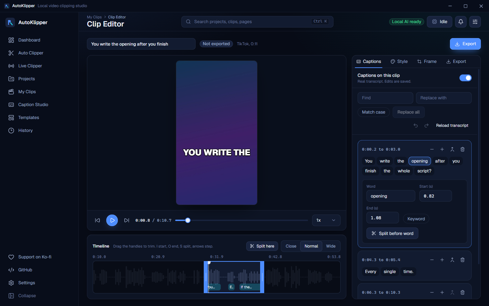
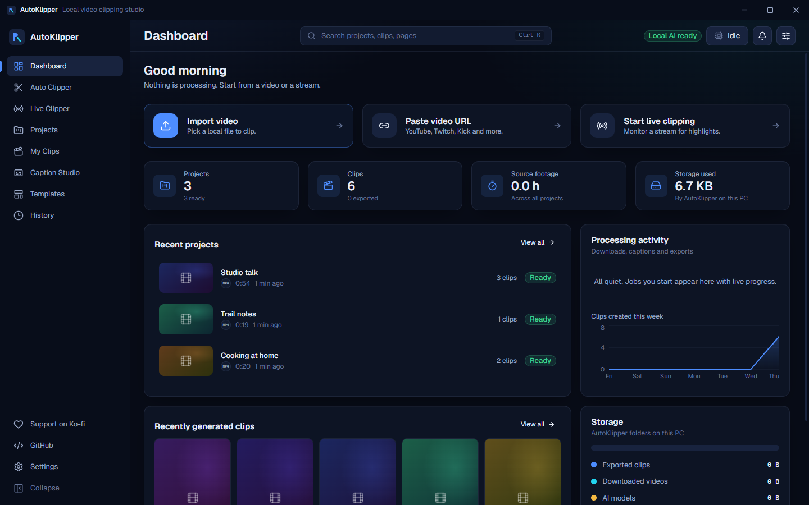
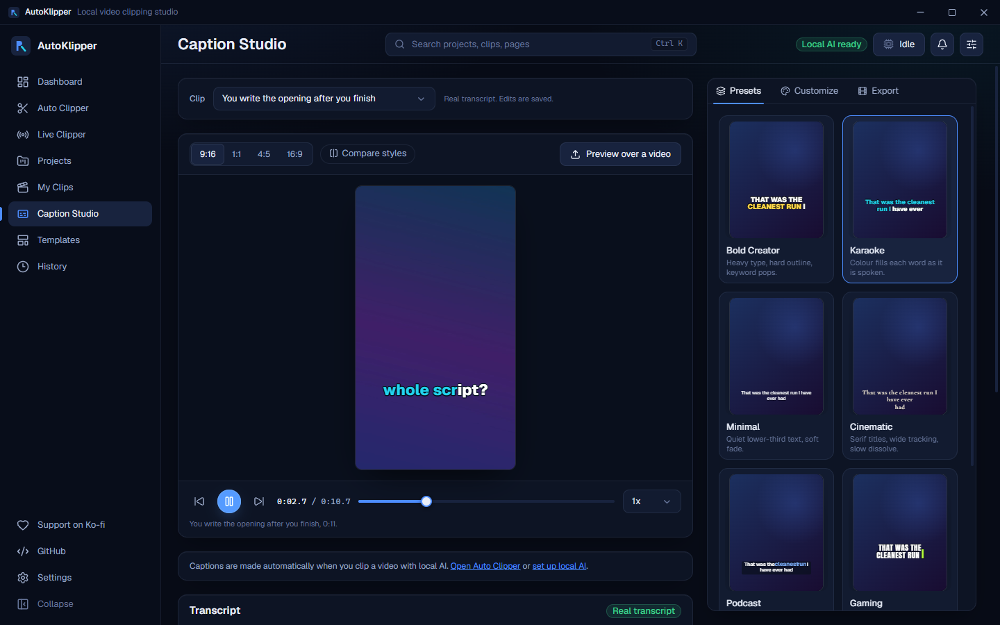
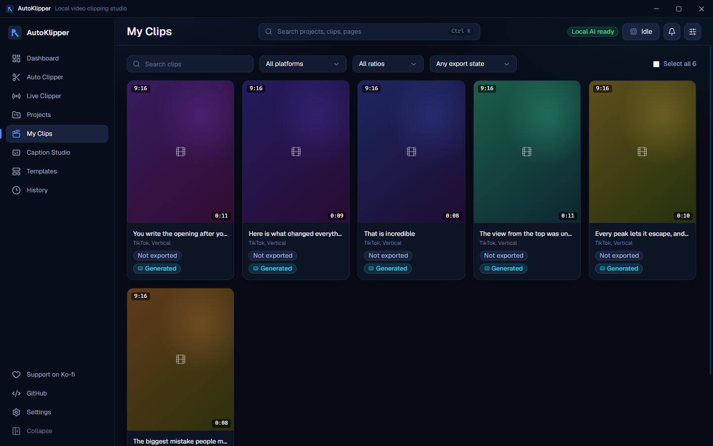

# AutoKlipper

**Turn long videos into captioned short clips, on your own PC.**

[**Download for Windows**](https://github.com/maeldotdev/AutoKlipper/releases/latest) &nbsp;&nbsp; [Report a bug](https://github.com/maeldotdev/AutoKlipper/issues) &nbsp;&nbsp; [Support on Ko-fi](https://ko-fi.com/mael22)

 

## What it does

- **Finds the moments.** Add a video file or paste a link. Local AI transcribes it and suggests highlight clips.
- **Captions by default.** Added automatically, editable word by word, and you can switch them off.
- **Fits every feed.** Export 9:16, 1:1, 4:5 or 16:9, with face tracking to keep people in frame.
- **Clips livestreams.** Watch a stream and save highlights while it runs.
- **Stays on your PC.** Transcription and editing happen locally. Free, with no account.

<table>
  <tr>
    <td width="50%"></td>
    <td width="50%"></td>
  </tr>
  <tr>
    <td align="center">Dashboard</td>
    <td align="center">Caption Studio</td>
  </tr>
</table>

## Install

1. Download the installer from [Releases](https://github.com/maeldotdev/AutoKlipper/releases/latest) and run it.
2. Follow the first-run setup. It shows what to install for FFmpeg, yt-dlp and Python, which are free.
3. Add a video and generate clips.

Windows may show "Unknown publisher" because the installer is not code-signed. You can check your download against `SHA256SUMS.txt` on the release page. Later versions are offered inside the app.

Only clip videos you have the right to use, and follow each platform's terms.

## Contribute

Found a bug or have an idea? [Open an issue](https://github.com/maeldotdev/AutoKlipper/issues). Pull requests are welcome; start with the [development guide](docs/DEVELOPMENT.md).

## Licence

[MIT](LICENSE). Free to use. If it helps you, [a Ko-fi tip](https://ko-fi.com/mael22) keeps it going. Third-party tools and models keep their [own licences](RELEASE_GUIDE.md).

Screenshots show demo recordings made for this page.
